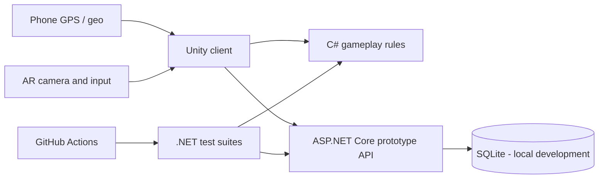

# MetinAR — GPS + augmented-reality RPG (prototype)

**Status:** private, actively developed prototype — **not a released Android/iOS game**.

MetinAR explores a location-based RPG in which GPS coordinates drive world navigation and an AR scene can present encounters in the camera view. The repository contains real Unity/C# and .NET components, but **having code and passing headless tests does not establish that the complete mobile gameplay loop works on a physical device**.

## Engineering snapshot

| Area | Implementation in repository | Evidence and limits |
| --- | --- | --- |
| Unity client | Unity Editor `6000.6.4f1`; C# modules under `client/Assets/MetinAR/Scripts/` | [Pinned editor version](client/ProjectSettings/ProjectVersion.txt); requires Unity runtime/device checks |
| GPS and geometry | Pure-C# coordinate and distance logic | [GeoCore test project](tests/GeoCore.Tests/) and [CI workflow](.github/workflows/geo-core-tests.yml) |
| Gameplay rules | C# damage, progression and combat-state logic | [Gameplay sources](client/Assets/MetinAR/Scripts/Gameplay/) and [test project](tests/MetinAR.Gameplay.Tests/) |
| Development API | ASP.NET Core / .NET 8, SQLite persistence, HTTP endpoints | [Backend README](server/README.md), [server tests](server/tests/MetinAR.Server.Tests/) |
| Repository QA | GitHub Actions, PowerShell checks and .NET tests | [QA gates](docs/METINAR-011-QA-GATES.md), [static CI](.github/workflows/qa-static.yml) |
| Android validation | QA APK / ADB inspection tooling is implemented | [Device QA procedure](docs/METINAR-037-QA-APK-ADB.md); a simulated harness is **not** a physical-device PASS |

### Architecture at a glance



This diagram describes repository components and intended integration boundaries; it is **not** a claim that every end-to-end runtime path is already validated.

## What is built vs. what needs verification

**Available to review in source**
- Unity project structure, scenes, assets and C# client modules.
- Geospatial computations, gameplay calculations and automated unit tests.
- Prototype server, API contracts, SQLite migrations and tests.
- Local QA scripts plus GitHub Actions for checks that do not require Unity.

**Not yet asserted as verified**
- A fully reliable GPS → map → encounter → AR fight → rewards journey on a physical phone.
- Stable frame rate, ARCore initialization, collision accuracy and input ergonomics across devices.
- A production-ready online backend, live authentication, security hardening or public server deployment.
- App Store / Google Play distribution.

Documented QA blockers and device verification belong in the [QA gates](docs/METINAR-011-QA-GATES.md) and [APK/ADB procedure](docs/METINAR-037-QA-APK-ADB.md), not in invented success claims.

## Reproduce technical checks

**Requirements:** .NET SDK 8 for the backend/test projects; Windows PowerShell and the pinned Unity Editor for full client/Android QA. Detailed requirements are described in linked documents.

From repository root, run engine-independent tests:

```bash
dotnet test tests/GeoCore.Tests/GeoCore.Tests.csproj -c Release
dotnet test tests/MetinAR.Gameplay.Tests/MetinAR.Gameplay.Tests.csproj -c Release
dotnet test server/MetinAR.Server.sln -c Release
```

Start the **local-development-only** backend:

```bash
dotnet run --project server/src/MetinAR.Server --launch-profile MetinAR.Server
```

The prototype backend has **no production authentication** and must not be publicly exposed without redesign and review. See [backend instructions](server/README.md).

For Unity/Android, open `client/` in Unity Editor **6000.6.4f1**, install the matching Android tooling and follow the gated Windows QA workflow:

```powershell
powershell -ExecutionPolicy Bypass -File tools\qa\Invoke-MetinARQa.ps1
```

For a physical Android phone, use [the device smoke-test procedure](docs/METINAR-011-QA-GATES.md) after enabling developer options/ADB, connecting and authorizing the device. Do **not** report a simulator or fake ADB run as device validation.

## Project constraints

- No proprietary Metin2 code or third-party copyrighted game assets without a license.
- Dynamic world events must avoid dangerous/inaccessible areas; the policies are part of the [project brief](docs/PROJECT_BRIEF.md), not a blanket guarantee that safety filtering is finished.
- No paid services or production deployment without approval.
- Document failures as failures. CI passing is scoped to the checks it actually runs.

## Portfolio evidence

- [Engineering case studies and trade-offs](docs/ENGINEERING_CASE_STUDIES.md)
- [Physical Android demo checklist and evidence log](docs/RECRUITER_DEMO_CHECKLIST.md)

## Recruiter / reviewer guide

1. Read the [project brief](docs/PROJECT_BRIEF.md) for intended gameplay and safety rules.
2. Inspect [combat logic](client/Assets/MetinAR/Scripts/Gameplay/DamageResolver.cs) and [deterministic unit tests](tests/MetinAR.Gameplay.Tests/DamageResolverTests.cs).
3. Explore the [ASP.NET backend](server/src/MetinAR.Server/) and its integration test suite.
4. Check [Actions runs](https://github.com/mromanowski832-ctrl/MetinAR-2026/actions) and verify the exact commit, job and result — status may change over time.
5. Review [APK QA documentation](docs/METINAR-037-QA-APK-ADB.md) before interpreting a mobile demo as production-ready.

**Demo video / public beta:** not provided until recorded from a verified device build.

---

### Podsumowanie po polsku

MetinAR to rozwijany prototyp gry RPG z GPS i rzeczywistością rozszerzoną. Repozytorium zawiera kod klienta Unity, logikę gry C#, backend .NET, testy automatyczne oraz narzędzia QA. **Nie deklaruję gotowej gry mobilnej ani pełnego testu na prawdziwym telefonie**, dopóki nie zostanie to potwierdzone raportem i nagraniem.
