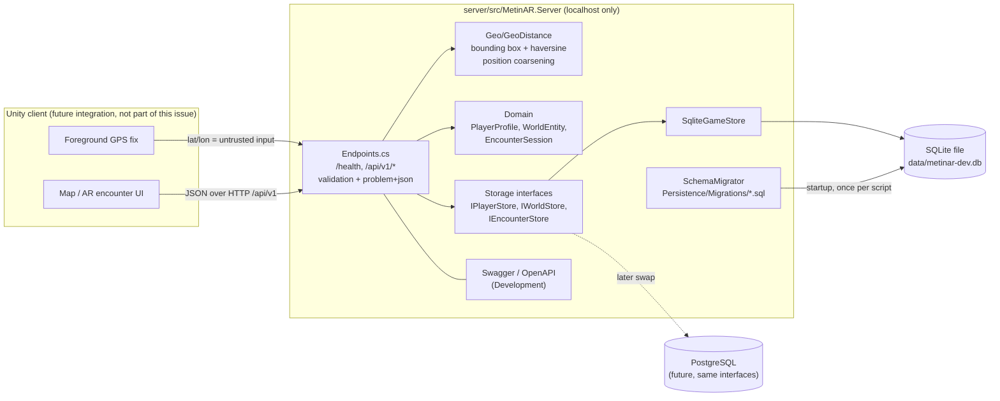
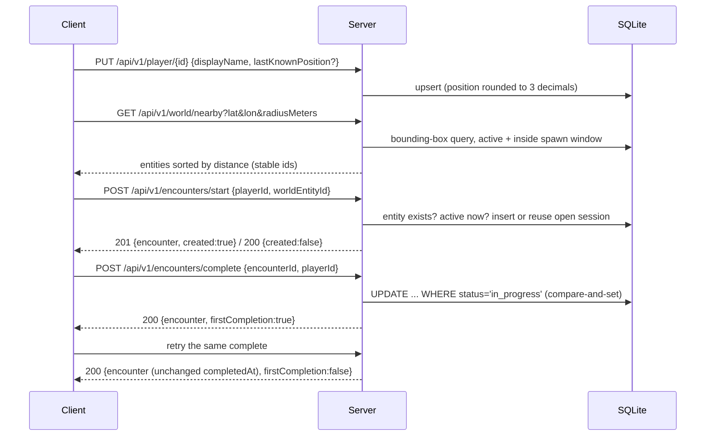

# METINAR-010 — Backend API + persistent player/world-state foundation

Status: prototype, local development only. Issue: #17. Code: [`server/`](../server/README.md).

This is a separate backend workspace. It doesn't touch the Unity client, AR encounter, hand tracking/sword,
GPS provider core, the map provider work or the 3D asset pipeline. The Unity client doesn't call it yet;
this document is the contract a later client integration issue will code against.

## 1. Stack

| Concern | Choice | License |
|---|---|---|
| Runtime | .NET 8 (LTS), ASP.NET Core Minimal API | MIT |
| Storage (dev) | SQLite through `Microsoft.Data.Sqlite` 8.0.11, native bundle `SQLitePCLRaw.bundle_e_sqlite3` 2.1.14 pinned explicitly (the transitive 2.1.6 is flagged by GHSA-2m69-gcr7-jv3q) | MIT / Apache-2.0 |
| OpenAPI | `Swashbuckle.AspNetCore` 6.9.0 (Swagger JSON + UI) | MIT |
| Tests | xUnit 2.9.2, `Microsoft.AspNetCore.Mvc.Testing` 8.0.11 (in-process TestServer) | Apache-2.0 / MIT |

No paid service, cloud account, API key or external network is used at runtime or in tests.
No ORM is used: SQL is plain and portable (see §8), so moving to PostgreSQL only replaces the storage class.

## 2. Architecture



Encounter flow:



## 3. Run locally

See [`server/README.md`](../server/README.md). Short version:

```bash
cd server
dotnet run --project src/MetinAR.Server --launch-profile MetinAR.Server
# http://localhost:5080/health, Swagger UI at http://localhost:5080/swagger
```

- Kestrel listens on `http://localhost:5080` only (`Urls` in `appsettings.json`); `AllowedHosts` is limited to localhost.
- Swagger is on when `ASPNETCORE_ENVIRONMENT=Development` (the launch profile sets it) or `Api__EnableSwagger=true`.
- The SQLite file `server/src/MetinAR.Server/data/metinar-dev.db` is created on first start and kept between restarts.
  It is git-ignored; delete the `data/` folder to reset.

## 4. Data model

All fields are technical and minimal. No classes, currency, skills, loot tables, rewards or monetization are modelled.

### PlayerProfile (`player_profiles`)

| Field | Owner | Notes |
|---|---|---|
| `id` | client chooses (prototype) | `^[A-Za-z0-9_-]{3,64}$`. Becomes an authenticated identity later (§10). |
| `displayName` | client | trimmed, 1–32 printable characters |
| `level`, `hp.current/max`, `mp.current/max`, `experience` | **server** | Set from `PrototypePlayerDefaults` on creation (level 1, HP 100/100, MP 100/100, XP 0). **These are placeholders, not game-design values**; override in config. The API refuses client writes to them. |
| `lastKnownPosition` | client report | **Coarse**: rounded to 3 decimals (~110 m) before storage. Prototype only; not used for any decision. |
| `createdAt`, `updatedAt` | server | UTC |

### WorldEntity (`world_entities`)

| Field | Notes |
|---|---|
| `id` | Stable, server-issued string (seed ids `seed-mob-0001`…). Never reused. |
| `type` | `mob` or `npc` |
| `templateId` | Technical placeholder reference (`prototype_mob_a`, …), not final content |
| `latitude`, `longitude` | WGS84 decimal degrees |
| `level`, `aggressive` | Copied to the client as-is; no balance implied |
| `active` (stored) | Manual on/off switch |
| `spawnedAt`, `despawnAt` | Spawn window `[spawnedAt, despawnAt)`; `despawnAt = null` means no end |

On the wire, `active` is the **effective** state: stored flag on **and** now inside the spawn window.

### EncounterSession (`encounter_sessions`)

| Field | Notes |
|---|---|
| `id` | Server-generated (32 hex chars) |
| `playerId`, `worldEntityId` | FK to the two tables above |
| `startedAt`, `completedAt` | UTC; `completedAt` is set exactly once |
| `status` | `in_progress` → `completed` (one-way) |

A partial unique index allows at most one `in_progress` session per (player, entity).

### Seed data

`0002_seed_synthetic_world.sql` adds six entities around **Null Island (0.0, 0.0)** in the Gulf of Guinea, an obviously
synthetic location. No owner, player or real venue location is in the repository.

| id | type | at | purpose |
|---|---|---|---|
| seed-mob-0001 | mob | (0.0005, 0.0005) ~79 m | active, aggressive |
| seed-npc-0001 | npc | (0.0, 0.001) ~111 m | active |
| seed-mob-0002 | mob | (0.002, -0.001) ~249 m | active, passive |
| seed-mob-0003 | mob | (0.0003, 0.0) | stored `active = 0` |
| seed-mob-0004 | mob | (0.0, -0.0003) | despawned 2026-01-02T00:00:00.000Z |
| seed-mob-0005 | mob | (0.05, 0.05) ~7.9 km | outside every allowed radius |

## 5. API contract (v1)

Base URL (dev): `http://localhost:5080`. JSON, UTF-8, camelCase. Requests must send `Content-Type: application/json`.
The canonical machine-readable schema is the generated OpenAPI document at `/swagger/v1/swagger.json`.

### 5.1 Versioning

- Game endpoints live under `/api/v1`. `/health` is unversioned.
- Within `v1`, changes are additive only (new optional request fields, new response fields).
  Clients must ignore unknown **response** fields.
- Removing/renaming a field, changing a type or meaning, or tightening validation requires `/api/v2`, served side by side with `v1` during migration.
- **Request** bodies are strict: unknown fields are rejected with `400 MALFORMED_REQUEST`. That is how the API refuses
  a client trying to set server-owned fields such as `level`.

### 5.2 Timestamps

Every timestamp is UTC ISO-8601 with millisecond precision and a literal `Z`: `2026-01-01T00:00:00.000Z`.
Clients parse it as UTC and never send local time. Storage uses the same text format.

### 5.3 `GET /health`

`200`:
```json
{ "status": "ok", "serverTime": "2026-10-20T02:36:22.237Z", "apiVersion": "v1", "schemaVersion": "0002_seed_synthetic_world" }
```
`503` with `"status": "degraded"` when the database can't be read.

### 5.4 `PUT /api/v1/player/{playerId}`

Creates the player (`201` + `Location`) or updates the client-editable fields (`200`).

Request:
```json
{ "displayName": "Demo", "lastKnownPosition": { "latitude": 0.0004, "longitude": 0.0004 } }
```
- `displayName` required. `lastKnownPosition` optional; when omitted the previous value is kept.
- Any other field (e.g. `level`, `hp`) → `400 MALFORMED_REQUEST`.

Response (`201`):
```json
{
  "id": "demo-player",
  "displayName": "Demo",
  "level": 1,
  "hp": { "current": 100, "max": 100 },
  "mp": { "current": 100, "max": 100 },
  "experience": 0,
  "lastKnownPosition": { "latitude": 0, "longitude": 0, "reportedAt": "2026-10-20T02:48:04.450Z" },
  "createdAt": "2026-10-20T02:48:04.450Z",
  "updatedAt": "2026-10-20T02:48:04.450Z"
}
```
(The reported 0.0004/0.0004 was coarsened to 0.000/0.000.) `lastKnownPosition` is `null` when never reported.

### 5.5 `GET /api/v1/player/{playerId}`

`200` with the same `PlayerProfile` shape, `404 PLAYER_NOT_FOUND`, or `400 VALIDATION_FAILED` for a malformed id.

### 5.6 `GET /api/v1/world/nearby?lat=&lon=&radiusMeters=&limit=&offset=`

| Param | Required | Range | Default |
|---|---|---|---|
| `lat` | yes | −90…90 | — |
| `lon` | yes | −180…180 | — |
| `radiusMeters` | no | 1…1000 | 250 |
| `limit` | no | 1…100 | 50 |
| `offset` | no | 0…10000 | 0 |

These are technical request limits (config section `ApiLimits`), not gameplay ranges.

Rules:
- Only effectively active entities (§4) are returned.
- Exact great-circle (haversine) distance ≤ `radiusMeters`, after an indexed bounding-box pre-filter.
  Requests near the antimeridian or poles skip the longitude pre-filter, so results stay correct.
- Order: `distanceMeters` ascending, ties broken by `id` (ordinal), so pages are stable for a fixed dataset and time.
- Paging: `totalInRadius` is the full match count; `nextOffset` is the offset of the next page or `null` on the last page.
  Pages are computed per request; entities that spawn or despawn between calls can shift later pages.

Response (`radiusMeters=120&limit=1`):
```json
{
  "center": { "latitude": 0, "longitude": 0 },
  "radiusMeters": 120,
  "serverTime": "2026-10-20T02:48:04.623Z",
  "offset": 0,
  "limit": 1,
  "totalInRadius": 2,
  "nextOffset": 1,
  "entities": [
    {
      "id": "seed-mob-0001", "type": "mob", "templateId": "prototype_mob_a",
      "latitude": 0.0005, "longitude": 0.0005, "level": 5, "aggressive": true, "active": true,
      "spawnedAt": "2026-01-01T00:00:00.000Z", "despawnAt": null, "distanceMeters": 78.6
    }
  ]
}
```
`distanceMeters` is rounded to 0.1 m and is informational.

### 5.7 `POST /api/v1/encounters/start`

Request:
```json
{ "playerId": "demo-player", "worldEntityId": "seed-mob-0001", "clientPosition": { "latitude": 0.0004, "longitude": 0.0004 } }
```
`clientPosition` is optional. It is range-checked but **not trusted or enforced** yet (§9).

Validation order: body fields → player exists (`404 PLAYER_NOT_FOUND`) → entity exists (`404 WORLD_ENTITY_NOT_FOUND`)
→ entity effectively active now (`409 WORLD_ENTITY_INACTIVE`).

Responses:
- `201` + `Location` — new session:
  ```json
  {
    "encounter": {
      "id": "20422490f7c34822ab7ab8267d73b19a", "playerId": "demo-player", "worldEntityId": "seed-mob-0001",
      "startedAt": "2026-10-20T02:48:04.490Z", "completedAt": null, "status": "in_progress"
    },
    "created": true
  }
  ```
- `200` with `"created": false` — an `in_progress` session for the same (player, entity) already exists and is returned
  as-is. Retrying `start` is therefore safe.

### 5.8 `POST /api/v1/encounters/complete`

Request:
```json
{ "encounterId": "20422490f7c34822ab7ab8267d73b19a", "playerId": "demo-player" }
```
Responses:
- `200` — always the stored session plus `firstCompletion`:
  ```json
  {
    "encounter": {
      "id": "20422490f7c34822ab7ab8267d73b19a", "playerId": "demo-player", "worldEntityId": "seed-mob-0001",
      "startedAt": "2026-10-20T02:48:04.490Z", "completedAt": "2026-10-20T02:48:04.556Z", "status": "completed"
    },
    "firstCompletion": true
  }
  ```
- `404 ENCOUNTER_NOT_FOUND`, `403 ENCOUNTER_PLAYER_MISMATCH` (session belongs to another player; it is not modified).

No reward, XP, loot or HP change is applied. The endpoint only records completion.

## 6. Idempotency rules

| Operation | Guarantee |
|---|---|
| `PUT /player/{id}` | Same body → same stored state (only `updatedAt` moves). |
| `POST /encounters/start` | At most one open session per (player, entity), enforced by a partial unique index plus `INSERT … ON CONFLICT DO NOTHING`. Retries return the open session with `created:false`. After completion, a new `start` opens a new session. |
| `POST /encounters/complete` | One atomic compare-and-set: `UPDATE … SET status='completed', completed_at=$now WHERE id=$id AND status='in_progress'`. Exactly one call ever gets `firstCompletion: true`. Retries, concurrent calls (tested with 16 in parallel) and calls after a server restart get `firstCompletion: false` and the original `completedAt`. |

**Rule for future rewards:** grant anything only inside the same transaction that observed the compare-and-set
succeed (`firstCompletion == true`). Never grant on the client's word or on a repeated call. Ideally record the grant in a
table keyed by `encounterId` with a unique constraint, so a second grant can't be written.

## 7. Error format

Every error is `application/problem+json` (RFC 9457) with two extensions: a stable `code` and a `traceId`.
Clients switch on `code` only; `title`/`detail` are human text and may change.

```json
{
  "type": "https://github.com/mromanowski832-ctrl/MetinAR-2026/blob/main/docs/METINAR-010-BACKEND.md#error-codes",
  "title": "One or more request fields are invalid.",
  "status": 400,
  "instance": "/api/v1/world/nearby",
  "code": "VALIDATION_FAILED",
  "traceId": "00-c29da7c11df1cd5f3d3aebb52fcabbac-526f9a0302b24091-00",
  "errors": {
    "radiusMeters": [ "Must be between 1 and 1000." ],
    "limit": [ "Must be between 1 and 100." ]
  }
}
```

### Error codes

| HTTP | `code` | When |
|---|---|---|
| 400 | `VALIDATION_FAILED` | A field is missing or out of range. `errors` maps field → messages. |
| 400 | `MALFORMED_REQUEST` | Unparseable JSON, wrong JSON type, unknown body field, or a non-numeric query value (`lat=abc`). |
| 403 | `ENCOUNTER_PLAYER_MISMATCH` | Completing someone else's encounter. |
| 404 | `PLAYER_NOT_FOUND` | Unknown player id. |
| 404 | `WORLD_ENTITY_NOT_FOUND` | Unknown world entity id. |
| 404 | `ENCOUNTER_NOT_FOUND` | Unknown encounter id. |
| 404 | `NOT_FOUND` | Unknown route. |
| 405 | `METHOD_NOT_ALLOWED` | Wrong HTTP method on a known route. |
| 409 | `WORLD_ENTITY_INACTIVE` | Entity exists but is switched off or outside its spawn window. |
| 500 | `INTERNAL_ERROR` | Unexpected failure. No stack trace or type names are returned. |

## 8. Persistence and migrations

- Schema and seed are versioned SQL files in `server/src/MetinAR.Server/Persistence/Migrations/`, embedded in the
  assembly and applied in filename order on startup by `SchemaMigrator`. Each runs in its own transaction and is
  recorded in `schema_migrations`. Re-running is a no-op.
- New schema changes go in a new numbered file (`0003_…sql`). Applied files are never edited.
- SQLite runs in WAL mode with foreign keys on.
- PostgreSQL path: the SQL uses only constructs PostgreSQL also supports (`TEXT`, `INTEGER`, `REAL`, `CHECK`,
  partial unique index, `ON CONFLICT`). The move means a `PostgresGameStore` implementing the same three
  interfaces, `$name` → `@name` parameters, `REAL` → `double precision`, and optionally native `timestamptz` and PostGIS
  for the radius query. The HTTP contract doesn't change.

## 9. Trust boundaries (prototype)

| Input | Trusted? | Today | Future check (not implemented) |
|---|---|---|---|
| `playerId` in path/body | **No** — anyone can claim any id | accepted after format check | derived from an authenticated session/token; never from the body |
| Client GPS (`lat/lon`, `lastKnownPosition`, `clientPosition`) | **No** | range-checked; profile position coarsened; never used to grant anything | server-side proximity check at encounter start (player ↔ entity distance vs. GPS accuracy), speed/teleport plausibility between reports, mock-location signals |
| Encounter outcome | **No** — complete is only "client says it's done" | recorded once, nothing granted | server-side combat/reward validation, minimum duration, server-issued encounter nonce |
| Server-owned stats | n/a | client writes rejected | — |
| World entities | server-authoritative | seeded via migration | spawn service with the project brief's safety rules (no roads, railways, water, buildings, private areas) |

## 10. Security baseline

In this prototype there are, on purpose:
- no authentication, passwords, OAuth, tokens or secrets (nothing to configure, nothing committed);
- no payment data;
- no public deployment: localhost binding, localhost `AllowedHosts`, Swagger only in Development.

**Do not expose this server beyond localhost.** It has no auth and trusts the caller's `playerId`.

Required before any non-local deployment (separate, owner-approved issues):
1. Authenticated player identity (e.g. platform sign-in → server-issued short-lived token); `playerId` comes from the token.
2. TLS, plus restricted CORS/hosts.
3. Rate limiting per identity and per IP (ASP.NET Core `RateLimiter`), with stricter limits on encounter endpoints.
4. Server-authoritative encounter and reward validation (§6 reward rule, §9 future checks).
5. Audit logging of encounter start/complete and any reward grant (who, what, when, from where), with retention rules.
6. Abuse controls: GPS-spoof heuristics, anomaly flags, account suspension tooling.
7. Privacy review of location storage (coarsening level, retention, deletion on request), with no background location.
8. Managed PostgreSQL with backups, secrets in a secret store (never in the repo), dependency vulnerability scanning in CI.

## 11. Verification

Commands (from `server/`) and results at PR time are in the PR description and the issue #17 review comment.
- `dotnet build MetinAR.Server.sln -c Release` — `TreatWarningsAsErrors` + `latest-recommended` analyzers.
- `dotnet format MetinAR.Server.sln --verify-no-changes`.
- `dotnet test MetinAR.Server.sln -c Release` — 54 tests: health, OpenAPI document + UI, 404/405 problem+json, nearby query (radius, ordering,
  spawn window, paging, limits), player upsert/validation/coarsening/server-owned fields, encounter start validation
  (unknown / inactive / despawned / unknown player / reuse), idempotent completion (sequential, 16 concurrent, after restart),
  wrong-player completion, migrations once-only, unique open-session constraint, geo math.
  All in-process against temp SQLite files; no network.
- `scripts/smoke-local.sh` — real server process on localhost: health, Swagger, nearby, player, encounter start/complete,
  **process restart**, persistence and idempotency after restart, localhost-only binding.
- `dotnet list MetinAR.Server.sln package --vulnerable --include-transitive` — no known vulnerable packages.

Not part of this issue: Unity compile, Play Mode, Android build and physical-device checks (no client change).
The repository's GitHub Actions workflow (`geo-core-tests`) does not run the server tests yet; adding a server job
is a small follow-up outside `server/` and `docs/`.

## 12. Known limitations / out of scope

- No authentication or real identity (by design, §10).
- Client position isn't checked against the entity at encounter start (documented future check).
- No rewards, XP, combat, loot or economy. `firstCompletion` is only the hook.
- `offset` paging isn't snapshot-consistent across spawn changes.
- No dynamic spawning; the world is the static synthetic seed.
- Unity client integration (HTTP client, DTO mirror) is a separate future issue.
