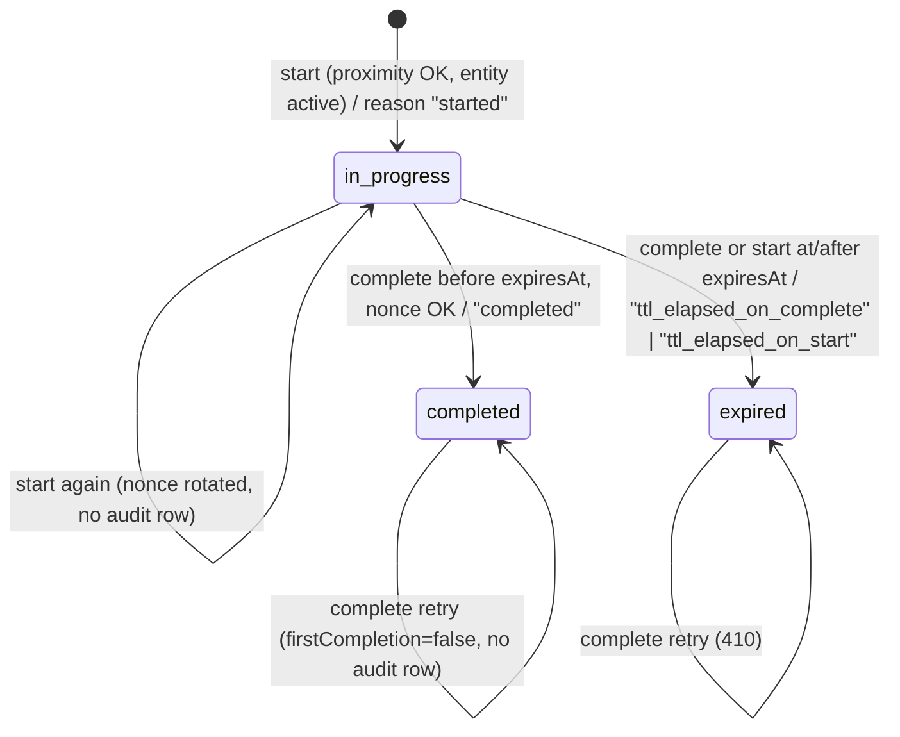
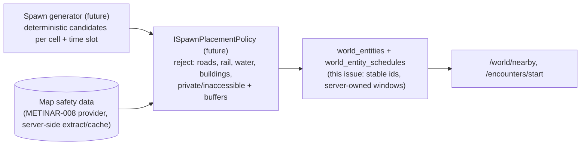

# METINAR-012 — Server-authoritative encounter proximity + spawn scheduling foundation

Status: prototype, local development only. Issue: #22. Builds on [METINAR-010](METINAR-010-BACKEND.md) (#17, PR #21).
Code: [`server/`](../server/README.md). Server-only: no Unity, AR, hand/sword, map renderer, GPS provider core or 3D asset change.

The METINAR-010 contract document stays the reference for the whole API and has been updated in place.
This document explains what METINAR-012 adds and why.

## 1. What changed

| Area | Before (METINAR-010) | Now (METINAR-012) |
|---|---|---|
| Encounter start | `clientPosition` optional, ignored | `clientPosition` **required**; server checks distance to the server-owned entity position, GPS accuracy and fix age |
| Encounter complete | `encounterId` + `playerId` | + `nonce` from the start response (replay protection) |
| Session lifetime | unlimited | `expiresAt = startedAt + EncounterTtlSeconds`; completion at/after it → `410 ENCOUNTER_EXPIRED`, status `expired` |
| Status audit | current row only | append-only `encounter_transitions` (from, to, at, reason) |
| Entity availability | flag + spawn window | flag + spawn window + optional deterministic schedule; `activeUntil` on the wire |
| Schema | `0002_seed_synthetic_world` | `0003_encounter_authority_and_spawn_schedules` |

**Contract note (decided, D3/Q1).** Making `clientPosition` and `nonce` required tightens `v1` requests. The versioning
rule in METINAR-010 §5.1 would normally require `/api/v2`. The owner decided ([#33, D3](https://github.com/mromanowski832-ctrl/MetinAR-2026/issues/33#issuecomment-6316048203)) to keep
the change in place in `/api/v1` with no `/api/v2`, because `v1` has no consumers yet. The "after" contract in §8 is the
`v1` baseline; the additive-only rule of METINAR-010 §5.1 applies to every change from here on.

## 2. Encounter proximity validation

Request (`POST /api/v1/encounters/start`):
```json
{
  "playerId": "demo-player",
  "worldEntityId": "seed-mob-0001",
  "clientPosition": {
    "latitude": 0.0005,
    "longitude": 0.00048,
    "horizontalAccuracyMeters": 5,
    "capturedAt": "2026-10-20T03:59:50.900Z"
  }
}
```
- `latitude`, `longitude`, `horizontalAccuracyMeters` are required. Accuracy is the platform's horizontal accuracy radius in meters
  (same meaning as the client's `LocationFix.HorizontalAccuracyMeters`). It must be finite and ≥ 0.
- `capturedAt` is optional (UTC). When sent it must be no older than `MaxFixAgeSeconds` and at most
  `MaxFutureSkewSeconds` in the future. It's optional because the client's fix timestamp can be provider-relative
  rather than UTC.

Decision (pure function `Domain/ProximityCheck.cs`), in order:

1. `accuracy > MaxAcceptedAccuracyMeters` → `422 GPS_ACCURACY_INSUFFICIENT`.
2. `capturedAt` too old or too far ahead → `422 GPS_FIX_STALE`.
3. `distance = haversine(client, entity)`, with `allowed = MaxStartDistanceMeters + min(accuracy, AccuracyAllowanceCapMeters)`.
   `distance > allowed` → `422 ENCOUNTER_TOO_FAR`, with `distanceMeters` (rounded to 1 m) and `allowedMeters` extensions.
4. Otherwise allowed.

Earlier checks still apply first: body validation (`400`), unknown player/entity (`404`), entity not effectively active (`409`).

Why this is conservative: uncertainty can widen the allowed radius by at most the cap (default 20 m), however bad the
fix is, and fixes worse than 50 m are refused outright. So a large reported accuracy never buys range. The client's own
aggro gate (METINAR-005A) is stricter and separate; the server check is a backstop against clearly wrong or forged
starts, not the gameplay trigger.

| Setting (`EncounterRules`) | Default | Meaning |
|---|---|---|
| `MaxStartDistanceMeters` | 40 | base allowed client ↔ entity distance |
| `AccuracyAllowanceCapMeters` | 20 | max extra tolerance for GPS uncertainty |
| `MaxAcceptedAccuracyMeters` | 50 | worse fixes are rejected |
| `MaxFixAgeSeconds` | 30 | max age of `capturedAt` |
| `MaxFutureSkewSeconds` | 5 | tolerated client clock skew |
| `EncounterTtlSeconds` | 600 | encounter session lifetime |

**These are PROTOTYPE technical limits, not game-balance values** (owner decision D3/Q3, [#33](https://github.com/mromanowski832-ctrl/MetinAR-2026/issues/33#issuecomment-6316048203): they stay
configuration and are explicitly marked as prototype; final values aren't set by this work). They are validated at startup (an invalid value stops
the server) and can be overridden per environment, e.g. `EncounterRules__MaxStartDistanceMeters=60`.

Example rejection:
```json
{
  "type": "https://github.com/mromanowski832-ctrl/MetinAR-2026/blob/main/docs/METINAR-010-BACKEND.md#error-codes",
  "title": "Too far from the world entity to start an encounter.",
  "status": 422,
  "instance": "/api/v1/encounters/start",
  "code": "ENCOUNTER_TOO_FAR",
  "traceId": "00-9f98f8c8718657e53e22af5a20a4aa63-bcb9a27c40ad7618-00",
  "distanceMeters": 334,
  "allowedMeters": 48
}
```

### Location privacy

- Client coordinates from a start request are **never stored and never logged**. The session stores only the rounded
  derived values `start_distance_meters`, `start_accuracy_meters` and `start_allowed_meters` (audit evidence).
- Rejections are logged as `Encounter start rejected: {Verdict} player=… entity=… distanceM=… accuracyM=…`, with no coordinates.
- Framework request logging (which would include query strings like `?lat=…`) stays at `Warning` for `Microsoft.AspNetCore`.
- Tests use synthetic coordinates around Null Island only. A test feeds distinctive coordinates through nearby, start and
  player update, then asserts none of them appear in any log line.

## 3. Replay / abuse protections

- **Nonce.** Every start response carries `nonce`: 32 random bytes, base64url, 43 characters. The server stores only its
  SHA-256 (`nonce_sha256`) and compares in constant time. Completion needs `encounterId` + `playerId` + `nonce`.
  A wrong or old nonce returns `403 ENCOUNTER_NONCE_MISMATCH` and changes nothing.
- **Nonce rotation.** Re-calling start for an open session returns the same session (`created: false`) with a **new**
  nonce. The previous one stops working, so only the most recent start response can complete it.
- **TTL.** `expiresAt = startedAt + EncounterTtlSeconds`. The completion compare-and-set is
  `UPDATE … SET status='completed' WHERE id=$id AND status='in_progress' AND expires_at > $now`. At or after `expiresAt`
  the session is moved to `expired` (`expiredAt` = the TTL deadline) and the call returns `410 ENCOUNTER_EXPIRED`;
  repeating it stays `410`. A new start for the same (player, entity) first expires a lapsed open session, then creates
  a fresh one.
- **No double completion.** An already completed session answers `200` with `firstCompletion: false` and the original
  `completedAt`, even after its TTL or a server restart. `firstCompletion: true` happens at most once per session; it
  remains the only allowed hook for future rewards (METINAR-010 §6).
- **Mob window ending mid-fight (decided, D3/Q2).** In v1 an open encounter ends only by completion or TTL. When the
  entity's spawn window or schedule phase ends after the start, the session isn't interrupted or expired: it can still
  be completed until `expiresAt`, and it expires at `expiresAt` as usual. Only *new* starts check entity activity
  (tests `Complete_AfterMobWindowEndsMidFight_StillSucceedsWithinTtl`, `OpenSession_AfterMobWindowEnds_ExpiresOnlyAtTtl`).
- **Expiry is lazy.** There's no background job. A lapsed open session is marked `expired` the next time it's
  touched (complete or start). Its effective state is still "expired" from `expiresAt` on, because completion checks the
  deadline atomically.

Status machine:



### Audit trail

`encounter_transitions` is append-only and written in the same transaction as the status change:

| column | example |
|---|---|
| `encounter_id` | `d837dca48ac74dfbb0e673f124a7bea0` |
| `from_status` | `NULL` (creation), `in_progress` |
| `to_status` | `in_progress`, `completed`, `expired` |
| `at` | `2026-10-20T03:59:51.091Z` (UTC, ms) |
| `reason` | `started`, `completed`, `ttl_elapsed_on_complete`, `ttl_elapsed_on_start` |

Rejected start attempts create no session, so they appear in the structured log only (§2), not in this table.

## 4. Spawn scheduling foundation

`world_entity_schedules (world_entity_id, anchor_at, period_seconds, active_seconds)`: starting at `anchor_at`, each
cycle of `period_seconds` begins with `active_seconds` of activity. The evaluation (`Domain/SpawnSchedule.cs`) is pure
integer tick arithmetic with no randomness or clock reads, so the same instant always gives the same answer on any
server and after any restart.

Effective activity = stored `active` flag **and** `spawnedAt ≤ now < despawnAt` **and** (no schedule **or** in an
active phase). Both `GET /world/nearby` and encounter start use the same rule. Nearby entities now include
`activeUntil`: the end of the current active phase or `despawnAt`, whichever is earlier; `null` means no end.
This is an additive field.

Synthetic seed (`0003`), placed ~2.2 km south of Null Island so they never show up in the METINAR-010 seed queries:

| id | at | schedule |
|---|---|---|
| seed-mob-0006 | (-0.0200, 0.0002) | anchor 2026-01-01T00:00Z, period 600 s, active 300 s → first 5 min of every 10 min |
| seed-npc-0002 | (-0.0200, -0.0002) | anchor 2026-01-01T06:00Z, period 86400 s, active 43200 s → 06:00–18:00 UTC daily |

Not included on purpose: random or live spawning, spawn density, per-player spawns, respawn-after-kill and any balance values.

## 5. Future integration points for map safety data

The project brief requires dynamic spawns to avoid roads, railways, water, buildings and inaccessible/private areas
with safety buffers. METINAR-008 chose the map provider. The intended seam (not implemented here):



1. **Placement policy.** A server-side `ISpawnPlacementPolicy.IsAllowed(point, entityType) → (bool, reason)` runs
   before any entity row is written. Seeded/manual entities could be re-validated by a batch job.
2. **Data source.** A server-side extract/cache of the chosen provider's safety layers (roads, rail, water, buildings,
   land use, access tags), kept versioned, with the dataset version stored per entity (`placement_dataset_version`).
   Clients never send safety data.
3. **Generation.** Deterministic seeds (cell id + time slot) so spawns are reproducible and testable, with output in
   the existing tables. Stable ids derived from the seed, never reused.
4. **Encounter-time recheck.** Encounter start may later also refuse when the entity's cell is flagged unsafe (closed
   area, temporary hazard), which needs a new problem code.
5. **Licensing/attribution.** Whatever data is cached server-side must follow the provider license (e.g. ODbL share-alike
   for OSM-derived databases). That is an owner/licensing decision before the cache is built.

## 6. Trust boundaries after METINAR-012

| Input | Trusted? | Enforced now | Still future |
|---|---|---|---|
| `playerId` | No | format only | authenticated identity (token-derived) |
| Client fix at start | No: evidence only | distance to server-owned entity with capped accuracy tolerance; poor/stale/invalid fixes rejected | speed/teleport plausibility across reports, mock-location / root signals, attestation |
| Encounter completion | No | nonce (latest start), owner check, TTL, single compare-and-set | server-side combat validation, minimum duration, rewards only on `firstCompletion` inside the same transaction |
| Entity availability | Server-owned | flag + spawn window + deterministic schedule | map-safety placement policy (§5), live spawning |
| Logs/DB | — | no client coordinates; nonce stored as hash | retention policy, audit export |

## 7. Verification (run on the Grok cloud box, .NET SDK 8.0.426)

From `server/`:
- `dotnet build MetinAR.Server.sln -c Release`: warnings are errors.
- `dotnet format MetinAR.Server.sln --verify-no-changes`.
- `dotnet test MetinAR.Server.sln -c Release`: 102 tests (54 METINAR-010 + 48 new; the 2 D3/Q2 tests were added after the owner decision).
  - METINAR-010 encounter/persistence tests changed only to send the now-required `clientPosition`/`nonce` and expect the new schema version.
  - New tests cover:
    - near starts allowed (including the accuracy-cap boundary);
    - distant/impossible starts rejected;
    - poor accuracy, invalid, missing and malformed fixes rejected;
    - stale/future `capturedAt` rejected;
    - configurable radius and TTL;
    - invalid configuration fails startup;
    - TTL expiry exactly at the deadline, just-before succeeds, expired session not reused;
    - wrong and rotated nonce rejected;
    - nonce absent from the DB file;
    - audit transitions;
    - log privacy;
    - schedule cycle maths and determinism over 100k cycles;
    - nearby activation/deactivation over a simulated day;
    - same results across restart;
    - encounter start honours the schedule;
    - an open session survives the mob window ending and expires only at the TTL (D3/Q2);
    - upgrade from a METINAR-010 database.
  - Mutation checks during development: dropping the TTL guard, ignoring distance, logging a coordinate and ignoring
    the schedule each make tests fail (3, 6, 1 and 3 tests).
- `scripts/smoke-local.sh`: real process on localhost, now including distant start rejected, wrong nonce rejected,
  nonce-based completion, schema version and a no-coordinates-in-log check across a restart.
- `dotnet list MetinAR.Server.sln package --vulnerable --include-transitive`.

- GitHub Actions `server-tests` (§10) runs the same build and test project on every push/PR touching `server/`.

Not applicable: Unity compile, Play Mode, Android build, physical device (no client change).

## 8. `v1` contract before/after (Q1 decided: in place, D3)

"Before" is `main` at METINAR-010 (#21, `8332eca`). "After" is this branch and, per the owner decision D3/Q1
([#33](https://github.com/mromanowski832-ctrl/MetinAR-2026/issues/33#issuecomment-6316048203)), it **is** the `v1` contract. The full endpoint-by-endpoint reference is
[METINAR-010 §5](METINAR-010-BACKEND.md#5-api-contract-v1).

### 8.1 Per endpoint

| Endpoint | Part | Before (METINAR-010) | After (METINAR-012) | Compatibility |
|---|---|---|---|---|
| `GET /health` | response | `schemaVersion: "0002_seed_synthetic_world"` | `schemaVersion: "0003_encounter_authority_and_spawn_schedules"` | value change, same shape |
| `GET/PUT /api/v1/player/{id}` | request/response | — | unchanged | unchanged |
| `GET /api/v1/world/nearby` | query | `lat, lon, radiusMeters?, limit?, offset?` | unchanged | unchanged |
| | response entity | `id, type, templateId, latitude, longitude, level, aggressive, active, spawnedAt, despawnAt, distanceMeters` | + `activeUntil` (UTC or `null`) | additive |
| | semantics | active = flag + spawn window | + deterministic schedule phase; scheduled entities can drop out of results between calls | behavioural (data-driven) |
| `POST /api/v1/encounters/start` | request | `playerId, worldEntityId, clientPosition?{latitude, longitude}` | `playerId, worldEntityId, clientPosition{latitude, longitude, horizontalAccuracyMeters, capturedAt?}` (**required**) | **breaking**: an old body without `clientPosition` gets `400 VALIDATION_FAILED`; an old `clientPosition` without accuracy gets `400` |
| | response | `{encounter{id, playerId, worldEntityId, startedAt, completedAt, status}, created}` | `{encounter{…, expiresAt, completedAt, expiredAt, status}, created, nonce}` | additive |
| | new errors | — | `422 ENCOUNTER_TOO_FAR`, `422 GPS_ACCURACY_INSUFFICIENT`, `422 GPS_FIX_STALE` | new rejection paths |
| | reuse semantics | repeat start returns the open session | same, plus a new `nonce` (the old one stops working); a lapsed session isn't reused | behavioural |
| `POST /api/v1/encounters/complete` | request | `encounterId, playerId` | `encounterId, playerId, nonce` (**required**) | **breaking**: an old body gets `400 VALIDATION_FAILED` |
| | response | `{encounter, firstCompletion}` | same shape; `encounter` gains `expiresAt`, `expiredAt`; `status` may be `expired` | additive (new enum value) |
| | new errors | — | `403 ENCOUNTER_NONCE_MISMATCH`, `410 ENCOUNTER_EXPIRED` | new rejection paths |

Unchanged: error envelope (problem+json + `code` + `traceId`), timestamp format, radius/paging limits, idempotency of
`firstCompletion`, localhost-only binding, no auth.

### 8.2 Who is affected today

No consumer of the API exists in the repository: the Unity client doesn't call the server, and no deployed instance
exists. The only callers are the server's own tests and `server/scripts/smoke-local.sh`, both updated in this PR.
Data: METINAR-010 dev databases upgrade in place (migration `0003`, covered by
`Upgrade_FromMetinar010Schema_KeepsRows_AndLegacyOpenSessionCannotBeCompleted`).

### 8.3 Options that were considered for Q1 (owner chose A, D3)

| Option | What it means | Consequences |
|---|---|---|
| **A — accept in place (chosen)** | `v1` = the "after" column; METINAR-010 §5.1 versioning rule starts to apply from the first real client | no extra code. Breaks only callers that don't exist yet. The doc history shows the tightening |
| B — `/api/v2` | keep a `v1` with the "before" request shape and add `v2` with the "after" shape | an unchecked `v1` start/complete path would bypass proximity, nonce and TTL, so `v1` would need to be disabled or also enforce the checks (then it isn't the "before" contract either). Duplicate routes and tests. Code change in this PR before merge |
| C — other | e.g. freeze the version label until the first client integration issue | needs an explicit owner rule |

## 9. Owner decisions (D3, recorded in [#33](https://github.com/mromanowski832-ctrl/MetinAR-2026/issues/33#issuecomment-6316048203); plan in `docs/audit/AUDIT_2026-10-21.md` §E.5/§F.4)

| Q | Question | Decision | Where it shows |
|---|---|---|---|
| **Q1** | `v1` tightened in place vs `/api/v2` | **In place in `/api/v1`, no `/api/v2`** (v1 has no consumers) | §1 contract note, §8, METINAR-010 §5.1 |
| **Q2** | End an encounter when the mob's active window ends mid-fight? | **No. In v1 an encounter ends only via TTL** (or completion); no interruption on despawn | §3, 2 tests in `SpawnScheduleTests` |
| **Q3** | Placeholder limits | **Stay as configuration, explicitly marked as prototype values**; no value change | §2, `appsettings.json` comment, `EncounterRules` XML doc, `server/README.md` |

Not decided by D3 and still open: final combat balance, rewards, player stat defaults (METINAR-010 §4), spawn safety
rules (S10 #55) and identity (#39).

## 10. CI

`.github/workflows/server-tests.yml` was added under the narrow scope approved by the controller in #33 / PR #27.
It runs on push and pull_request for `server/**` and the workflow file, with `permissions: contents: read`, .NET 8.0.x,
`dotnet restore` → `dotnet build -c Release` (warnings are errors) → `dotnet test server/tests/MetinAR.Server.Tests -c Release`
(non-zero exit on any failing test fails the job), and uploads the TRX result as an artifact.
It uses no secrets, deployment, production database, write permission or paid service. The smoke script and
`dotnet format` are not part of this job (out of the approved compile/test scope); they remain local gates.
